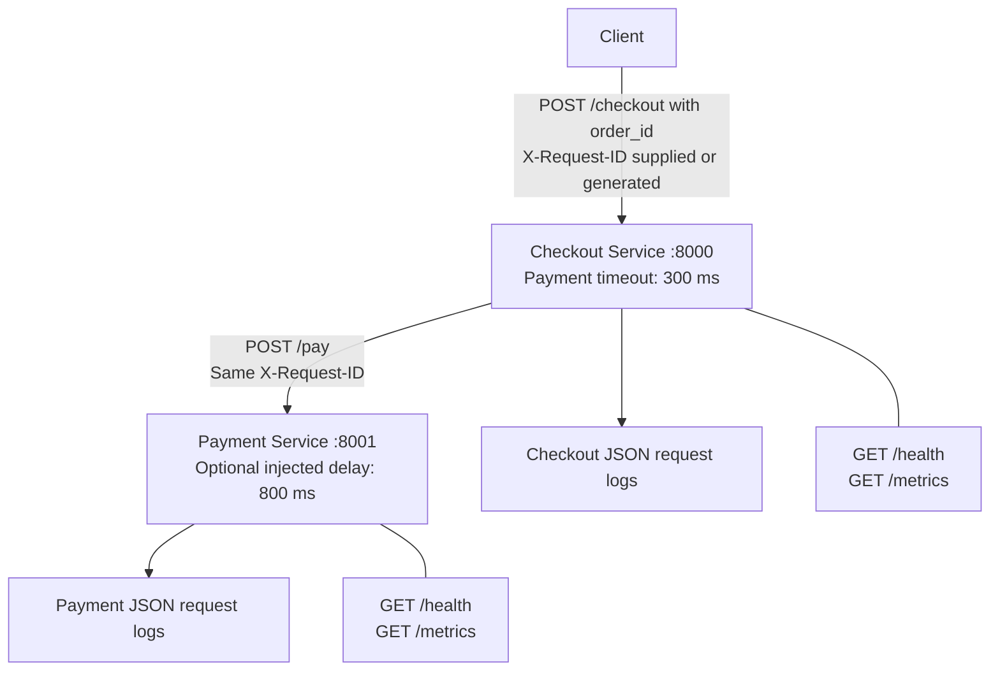

# Checkout and Payment: fault tolerance and observability lab

Two Python HTTP services demonstrate a successful checkout, a downstream timeout, and recovery without restarting either service. The repository includes source code, a reproducible experiment, an integration test, and captured terminal output, JSON logs, and metrics. Payment is a mock: no money is charged and no orders are persisted.

## Architecture



Checkout returns HTTP `200` when Payment succeeds, `504` on a downstream timeout, or `502` on a downstream connection/HTTP error. Both services use `ThreadingHTTPServer` so a delayed payment does not block other handlers. This small local lab binds to `127.0.0.1`; it needs neither containers nor a monitoring server.

## Run both services

Requires **Python 3.10+** and, for the manual examples, `curl`. All Python code uses the standard library; there is nothing to install. Run commands from the repository root. On Windows, use separate PowerShell terminals and adapt the file-writing commands below.

Terminal 1:

```sh
printf '0\n' > /tmp/payment-delay.txt
python3 -m services.payment --port 8001 --delay-file /tmp/payment-delay.txt
```

Terminal 2:

```sh
python3 -m services.checkout --port 8000 \
  --payment-url http://127.0.0.1:8001 --payment-timeout 0.3
```

Terminal 3:

```sh
curl -i http://127.0.0.1:8000/checkout \
  -H 'Content-Type: application/json' -H 'X-Request-ID: demo-success' \
  -d '{"order_id":"order-123"}'
curl http://127.0.0.1:8000/metrics
curl http://127.0.0.1:8001/metrics
```

The response is HTTP `200`, includes `X-Request-ID: demo-success`, and has this body:

```json
{"status":"confirmed","order_id":"order-123","payment":{"status":"paid","order_id":"order-123","request_id":"demo-success"},"request_id":"demo-success"}
```

To inject the failure, atomically replace the delay file. Payment reads its value at the start of every `/pay` request.

```sh
printf '0.8\n' > /tmp/payment-delay.next
mv /tmp/payment-delay.next /tmp/payment-delay.txt
curl -i http://127.0.0.1:8000/checkout \
  -H 'Content-Type: application/json' -H 'X-Request-ID: demo-timeout' \
  -d '{"order_id":"order-456"}'
curl -i http://127.0.0.1:8000/health
```

The checkout returns HTTP `504` with `{"error":"payment_timeout","request_id":"demo-timeout"}` after roughly 300 ms. `/health` still returns HTTP `200`. Wait about a second for the delayed Payment handler to finish before inspecting its completed-request metrics.

Remove the delay and try again, keeping both processes running:

```sh
printf '0\n' > /tmp/payment-delay.next
mv /tmp/payment-delay.next /tmp/payment-delay.txt
curl -i http://127.0.0.1:8000/checkout \
  -H 'Content-Type: application/json' -H 'X-Request-ID: demo-recovered' \
  -d '{"order_id":"order-789"}'
```

The response is HTTP `200` again. Stop each service with Ctrl+C. Omitting `--delay-file` starts Payment with no injected delay.

## Reproduce the complete experiment

```sh
python3 -m scripts.demo --output /tmp/checkout-lab-evidence
python3 -m unittest discover -s tests -v
```

The demo starts its own two services on available local ports, performs **3 successful, 3 timed out, and 6 recovered checkouts**, and stops its child processes afterward. It changes the delay file from `0` to `0.8` to `0`, and asserts the expected status codes, shared request IDs, health after every request, process survival, correlated fault logs, declining cumulative error ratio, and recovering latency (a mean below 100 ms). It exits nonzero if a check fails. The integration test also checks the final counters and histogram counts in metrics captured from the real servers. Three additional regression tests cover a dropped Payment connection (Checkout returns 502), invalid delay configuration (Payment returns 500), and invalid order input (400).

The committed [terminal output](evidence/terminal.txt), [summary](evidence/summary.json), and [test output](evidence/tests.txt) were captured from actual runs with Python 3.13.14. UTC timestamps in the service logs correspond to November 17, 2026 in Pacific time. To replace the committed demo evidence with a new run, use `python3 -m scripts.demo` (default output: `evidence/`); measured times will vary.

## Recorded results

| Phase | Payment delay | Checkout outcomes | Phase error ratio | Cumulative error ratio | Mean client latency |
| --- | --- | --- | --- | --- | --- |
| Success | 0 ms | 3 × HTTP 200 | 0% | 0/3 = 0% | 3.574 ms |
| Failure | 800 ms | 3 × HTTP 504 | 100% | 3/6 = 50% | 303.487 ms |
| Recovery | 0 ms | 6 × HTTP 200 | 0% | 3/12 = 25% | 2.251 ms |

Excerpt from [terminal.txt](evidence/terminal.txt) (response bodies trimmed):

```text
POST /checkout X-Request-ID=success-01 -> HTTP 200 9.230ms
POST /checkout X-Request-ID=failure-01 -> HTTP 504 303.149ms
GET /health -> HTTP 200; both original service processes still running
POST /checkout X-Request-ID=recovery-01 -> HTTP 200 5.758ms
PASS: success, timeout detection, health, shared IDs, metrics, and recovery verified.
```

The full terminal file includes response bodies and results for all 12 requests. There were no service restarts between phases, so the counters are continuous. Error counters never decrease: the **fraction of requests that fail** decreases as successful requests accumulate. The phase error ratio drops from 100% during failure to 0% during recovery. This small experiment reports ratios over fixed batches, rather than an error rate per second.

### Follow one failed request across services

Search both JSON log files for the same ID:

```sh
grep -h '"request_id": "failure-01"' evidence/checkout.jsonl evidence/payment.jsonl
```

Selected actual entries, ordered here by timestamp:

```jsonl
{"timestamp": "2026-11-18T00:35:10.244319+00:00", "service": "checkout", "event": "payment_call_started", "request_id": "failure-01", "timeout_seconds": 0.3}
{"timestamp": "2026-11-18T00:35:10.244541+00:00", "service": "payment", "event": "request_started", "request_id": "failure-01", "method": "POST", "path": "/pay"}
{"timestamp": "2026-11-18T00:35:10.244594+00:00", "service": "payment", "event": "delay_injected", "request_id": "failure-01", "delay_seconds": 0.8}
{"timestamp": "2026-11-18T00:35:10.545680+00:00", "service": "checkout", "event": "payment_timeout", "request_id": "failure-01", "timeout_seconds": 0.3}
{"timestamp": "2026-11-18T00:35:10.546248+00:00", "service": "checkout", "event": "request_completed", "request_id": "failure-01", "status": 504, "duration_ms": 301.931}
{"timestamp": "2026-11-18T00:35:11.050519+00:00", "service": "payment", "event": "client_disconnected", "request_id": "failure-01"}
{"timestamp": "2026-11-18T00:35:11.050804+00:00", "service": "payment", "event": "request_completed", "request_id": "failure-01", "status": 499, "duration_ms": 806.233}
```

The ID establishes that Checkout reached Payment, Payment delayed for 800 ms, and Checkout stopped waiting after its 300 ms timeout. Payment continued working and later observed a disconnected caller. `499` is an internal logging classification for a failed response write; it is not sent to Checkout. A late write can also succeed into a socket buffer, producing a Payment-local `200` even though Checkout returned `504` (see `failure-02` in [payment.jsonl](evidence/payment.jsonl)). This is why Checkout metrics determine the client-facing outcome.

### Metrics evidence

Both `/metrics` endpoints expose success/failure counters and a latency histogram in seconds. Completed POST requests are instrumented; `/health` and `/metrics` probes are excluded. Outcomes below 400 count as success, and other outcomes count as failure. Logs also record each POST's method, path, HTTP status, duration in milliseconds, and request ID. Metrics are held in memory and reset on process restart.

After the failure phase, [Checkout metrics](evidence/failure-checkout.prom) include:

```text
app_requests_total{service="checkout",outcome="success"} 3
app_requests_total{service="checkout",outcome="failure"} 3
app_request_duration_seconds_count{service="checkout"} 6
app_request_duration_seconds_sum{service="checkout"} 0.916315
```

After recovery, [Checkout metrics](evidence/recovery-checkout.prom) include:

```text
app_requests_total{service="checkout",outcome="success"} 9
app_requests_total{service="checkout",outcome="failure"} 3
app_request_duration_seconds_count{service="checkout"} 12
app_request_duration_seconds_sum{service="checkout"} 0.924570
```

The six additional requests introduced zero errors and only `0.008255` seconds of total server time, averaging **1.376 ms per recovered request** on Checkout. Client measurements in the table include local HTTP overhead. Use differences in histogram `_sum` and `_count` between snapshots to measure each phase; the cumulative mean retains the earlier slow requests. All six phase/service snapshots, including Payment's, are in [evidence/](evidence/).

## Scope and limitations

Request IDs provide basic cross-service tracing through correlated logs, rather than an OpenTelemetry span collector. A valid `X-Request-ID` (1–128 letters, digits, dots, underscores, or hyphens) is propagated; absent or invalid IDs are replaced with a UUID and returned in the response. Request IDs stay out of metric labels to avoid unbounded label growth. Durations use a monotonic clock.

The downstream timeout bounds socket operations for this local experiment; it is not a total end-to-end deadline across DNS resolution and every possible read. A timeout does not cancel work already running in Payment. There are no automatic retries: a real payment integration would need idempotency and reconciliation before retrying a request whose outcome is unknown. The threaded development servers and local fault-injection file are intended for this lab.

## Reflection

Logs explain individual events, such as when Payment injected a delay and when Checkout detected a timeout. A shared request ID connects those events across services, making it possible to identify the slow dependency instead of treating each service's errors in isolation. Metrics show how broadly the failure affects requests and quantify the rise in errors and latency. Together, these signals establish the cause of this failure and verify that requests return to normal after the delay is removed.
